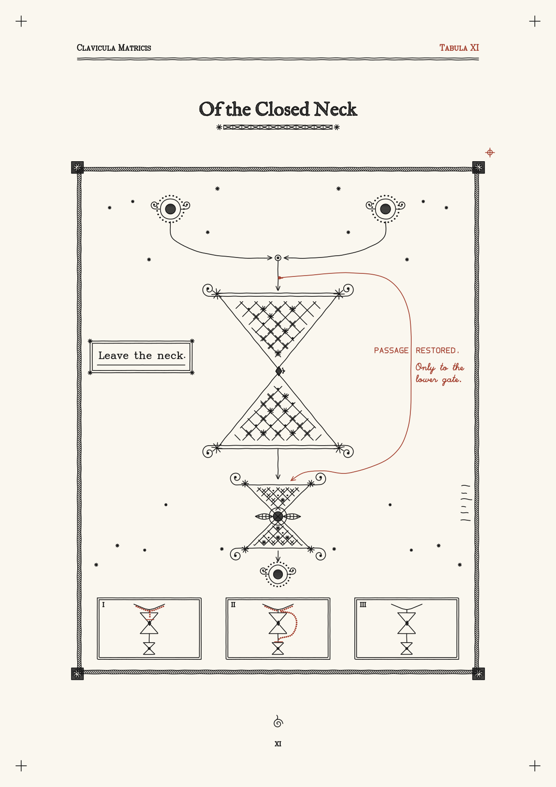

# Tabula XI · Of the Closed Neck · pen plotter edition

A two-pen adaptation of the existing plate for an SVG-based iDraw workflow.
The black impression retains the two gates. The red intervention bypasses the
upper gate and ends above the lower one. The third trial field remains unentered.



## Ready-to-plot files

The committed edition is **A4 portrait, 210 × 297 mm**, with approximately
160 × 264 mm of artwork. Optional registration crosses extend to 6 mm from the
page edges. The files have identical page dimensions, origins and coordinates.

| File | Use |
| --- | --- |
| [closed-neck-black.svg](a4/closed-neck-black.svg) | First pen: black impression and lettering. |
| [closed-neck-red.svg](a4/closed-neck-red.svg) | Second pen: bypass, trial traces and red labels. |
| [closed-neck-combined.svg](a4/closed-neck-combined.svg) | Both colours as named Inkscape layers; also a preview. |
| [pen-test-black.svg](a4/pen-test-black.svg) | Small first-pass test on the same A4 coordinate system. |
| [pen-test-red.svg](a4/pen-test-red.svg) | Matching overprint crosses and small red lettering. |
| [pen-test-combined.svg](a4/pen-test-combined.svg) | Combined test sheet. |
| [plot-stats.json](a4/plot-stats.json) | Source fingerprint, dimensions, pen travel and stroke counts. |

**Test status:** rendered and checked digitally; not yet run on an iDraw. These
are ordinary SVGs, not machine commands or a promise of compatibility with every
iDraw model/driver. Use your installed SVG plotting workflow and its motion
preview. The controller's pen height, speed and physical pen width remain local
settings; an SVG stroke width does not set them.

## First physical trial

1. Download the **raw SVG files**, rather than saving the GitHub preview. Start
   with the two `pen-test` files on scrap paper. Confirm that your machine's
   travel accommodates the declared page and that the SVG remains 210 × 297 mm.
2. Use a fine pen around **0.25–0.30 mm** for the first trial. Plot black, then red,
   without moving the sheet or changing its origin. Keep the same page transform
   for both files: do not crop, centre or scale each pass to its own drawing bounds.
3. Check that the red crosses cover the black crosses and that the small labels
   remain readable. The three hatch samples have **0.35, 0.50 and 0.75 mm
   centre-to-centre spacing**. Inspect for ink spread and excessive pressure.
4. On a fresh secured sheet, plot `closed-neck-black.svg`, change pens, and plot
   `closed-neck-red.svg`. Keep the machine's coordinate origin fixed when swapping
   pens. If pen handling requires a re-home in your workflow, preserve the same
   physical origin and paper position.
5. The `registration` group is a separate layer in every file. Omit that group
   in both passes for an unmarked final sheet after alignment has been established.
   The smaller red witness beside the plate is part of the original artwork and
   remains in the red layer. When using the combined SVG, draw each colour layer
   once; do not also plot the corresponding separate file.

The main black pass contains **2,350 strokes / 7.807 m** of pen-down motion; red
contains **220 strokes / 0.507 m**. Each separate pass adds eight optional
registration strokes. Pen lifts and acceleration can dominate runtime, so these
figures are not time estimates.

## What changed for the physical edition

- Kept the source routes, gates, hatch patterns, terminal figures, inset, trial
  fields, ornament and practice mark. The original SVG and PDF are unchanged.
- Removed simulated paper tone, foxing, highlight rules and a faded rehearsal.
  The physical paper supplies the ground.
- Replaced dark filled geometry with contour and hatch strokes. The light stars
  in the dark corner tablets are retained as gaps in the hatching.
- Reset the lettering in the plate's three hands, all as single strokes: engraved
  small capitals and roman in Hershey Times (running heads, inset, trial numerals,
  folio); the plotter's own monoline capitals for its PASSAGE RESTORED stamp; and
  Hershey Script for M.'s rust note. The large title keeps the repository's IM FELL
  English outlines, hatched solid at the same spacing as other filled areas.
- Mapped the original sepia linework to the black pen. Red remains a separate pass.
- Flattened curves to polylines (0.015 mm control-polygon tolerance), simplified
  sub-pen jitter at 0.015 mm, removed exact duplicate strokes, and ordered paths
  by nearest endpoint. No disconnected strokes are joined: important gaps remain.
- Added matching outer registration crosses and a separate test sheet. The cream
  ground in the PNG previews is only a preview background; there is no background
  rectangle in the plotting SVGs.

Every SVG contains only explicit line paths in millimetres and layer groups,
plus title/description metadata. There are **no live fonts, fills, images, masks,
clipping paths, opacity effects, or transforms** for a plotter to interpret.

## Rebuild or change the sheet size

Requires Python 3.10+ and the packages in `requirements.txt` (fontTools, Shapely, Hershey-Fonts). The exporter
reads `canvas/assets/xi_face.svg` and the title font already in this repository.
It does not run the original generators or depend on their absolute workspace
paths. Source provenance is recorded as SHA-256 in `plot-stats.json`.

From the repository root:

```bash
python -m venv .venv-plotter
# Activate this environment in your shell, then:
python -m pip install -r plotter/requirements.txt
python plotter/build.py
```

The default regenerates `plotter/a4/`. Use a distinct output directory for a
different format:

```bash
python plotter/build.py --page a3 --output plotter/a3
python plotter/build.py --page letter --output plotter/letter
python plotter/build.py --width-mm 250 --height-mm 350 --output plotter/custom
```

The plate is proportionally fitted within the requested margins (12 mm default).
It is not stretched. Dimensions should describe the sheet/coordinate area you
actually use, not a guessed machine limit. Scaling alters the minimum details;
a smaller format needs its own pen test. The committed A4 lettering is about
1.6 mm high at its smallest (trial numerals and folio).

For a different pen, adjust both the preview stroke and the new solid-area
hatching. Existing engraved hatch spacing scales with the artwork:

```bash
python plotter/build.py --pen-mm 0.30 --hatch-mm 0.40 --output plotter/a4-030
```

Optional PNG previews need CairoSVG and its platform dependencies:

```bash
python -m pip install cairosvg
python plotter/build.py --preview
```

The geometry exporter itself does not need CairoSVG. Each build validates the
SVG element set, page origin, finite coordinates, page bounds, and one continuous
stroke per path. Run the additional release checks with:

```bash
python -m unittest discover -s plotter -p 'test_*.py'
```

The source is deliberately specific to XI's palette and flat path structure.
Other plates need their own decisions about fills, lettering and particle
textures; this is not a general PDF/SVG-to-plotter converter.
